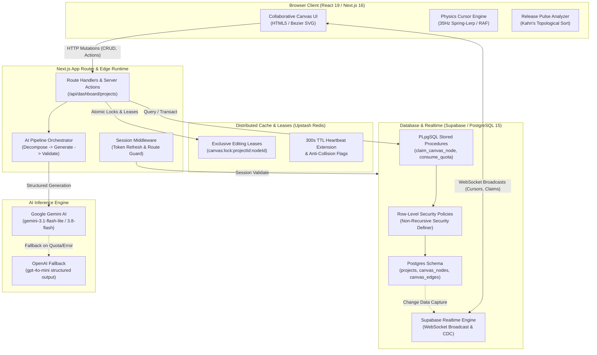

# NovaStage

> **Real-time collaborative canvas for engineering roadmaps and AWS architecture diagrams, powered by PostgreSQL Row-Level Security, Redis distributed editing leases, and multi-phase Gemini AI orchestration.**

[](https://github.com/AyoubElleuch/NovaStage/actions/workflows/ci.yml)
[](https://nextjs.org/)
[](https://www.typescriptlang.org/)
[](https://supabase.com/)
[](https://upstash.com/)
[](https://vitest.dev/)

---

## Authorship

I directed the product, architecture, collaboration rules, and behavioral testing. AI wrote the application code as an experiment in AI-assisted development. This project demonstrates that experiment and its implemented behavior; it is not presented as independently handwritten application code.

## Overview

NovaStage is a real-time collaborative workspace designed for software architects and engineering teams to model roadmaps, milestones, and AWS cloud architectures on a shared infinite canvas.

Unlike generic whiteboard tools that treat diagrams as unstructured vectors, NovaStage treats the canvas as a **typed, validated Directed Acyclic Graph (DAG)**. Milestone dependencies, AWS service connections, and resource topologies are validated both client-side and server-side, rejecting cyclic milestone dependencies, enforcing permission boundaries at the database layer, and orchestrating complex cloud designs via Google Gemini AI.

### Key Capabilities

- **Shared canvas**: Supabase Broadcast carries cursor and editing events. PostgreSQL stores canvas state; optimistic updates and snapshot refreshes handle interaction and recovery. Production latency has not been benchmarked.
- **AWS Cloud Architecture Modeling**: Full catalog of 300+ official AWS services with category metadata, typed infrastructure connections (`data_flow`, `network`, `event`, `dependency`), container groups (VPCs, Subnets), and configuration drawers.
- **Multi-Phase AI Generation**: 3-stage AI pipeline (Architectural Decomposition &rarr; Structured DAG Generation &rarr; Algorithmic Repair) using Google Gemini with OpenAI fallback chains.
- **Release Pulse Topological Engine**: Graph-based project health analyzer utilizing Kahn's topological sorting to calculate critical paths, blocked milestones, completion percentages, and release readiness in real time.
- **Roles and permissions**: Fine-grained permission model (`admin:access`, `waitlist:manage`, `roles:manage`) backed by non-recursive PostgreSQL Row-Level Security (RLS) policies and session middleware.
- **View-only canvas links**: Owners can enable or revoke an unguessable public link. Visitors can pan, zoom, search, and inspect the canvas without signing in; project identity, members, editing claims, and mutation access remain private. Canvas text, notes, and resource configuration are visible to anyone holding the link.

---

## System Architecture



---

## Key Engineering Highlights

### 1. Deterministic Graph Validation & Self-Healing Pipeline
*Implementation: [`src/lib/ai/phases/validate.ts`](src/lib/ai/phases/validate.ts), [`src/lib/canvas/coordinate-math.ts`](src/lib/canvas/coordinate-math.ts)*

AI workflow outputs and manual user connections are treated as mathematical directed graphs that must adhere to DAG invariants. The validation engine performs an algorithmic three-phase sanitation sweep before persisting canvas state:

- **Depth-First Search (DFS) Cycle Detection**: A three-color graph coloring algorithm ($O(V + E)$ complexity) maintains an active recursion stack (`recStack`) alongside visited sets. When a back-edge $(u, v)$ is discovered targeting an active ancestor in the recursion stack, the cycle is detected, recorded in a `ValidationReport`, and severed without crashing the pipeline.
- **Interactive Connection Guard**: When a user drags a connection between nodes on the canvas, `detectCycle()` executes client-side DFS from the proposed target node back to the source node. If the target can reach the source, the connection is instantly rejected with user feedback, preventing circular deadlocks before any database mutation occurs.
- **Orphan Auto-Stitching & Dangling Edge Pruning**: Unconnected nodes generated during generative decomposition are identified and sequentially connected into logical predecessor layers. Conversely, edges referencing nonexistent node IDs are automatically pruned.
- **Topological Critical Path Analysis**: [`src/lib/canvas/release-pulse.ts`](src/lib/canvas/release-pulse.ts) uses Kahn's algorithm (in-degree tracking) to derive the longest incomplete execution path and actionable unblocked milestones.

```typescript
// Excerpt from src/lib/ai/phases/validate.ts
function removeGraphCycles(nodeIds: Set<string>, edges: AIProcessedEdge[]) {
  const adj = new Map<string, string[]>();
  nodeIds.forEach((id) => adj.set(id, []));
  edges.forEach((e) => {
    if (adj.has(e.fromId) && adj.has(e.toId)) adj.get(e.fromId)!.push(e.toId);
  });

  const visited = new Set<string>();
  const recStack = new Set<string>();
  const invalidEdges = new Set<string>();
  let cyclesBroken = 0;

  function dfs(u: string) {
    visited.add(u);
    recStack.add(u);
    for (const v of adj.get(u) || []) {
      if (!visited.has(v)) {
        dfs(v);
      } else if (recStack.has(v)) {
        invalidEdges.add(`${u}->${v}`); // Back-edge detected
        cyclesBroken++;
      }
    }
    recStack.delete(u);
  }
  // Runs DFS across all roots...
  return { cleanEdges: edges.filter((e) => !invalidEdges.has(`${e.fromId}->${e.toId}`)), cyclesBroken };
}
```

---

### 2. Two-Tier Distributed Concurrency & Redis Lease Locking
*Implementation: [`src/lib/redis/client.ts`](src/lib/redis/client.ts), [`src/lib/canvas/server.ts`](src/lib/canvas/server.ts), [`supabase/migrations/009_canvas_collaboration.sql`](supabase/migrations/009_canvas_collaboration.sql)*

To prevent "last-write-wins" race conditions during concurrent editing, NovaStage uses a dual-layer cooperative concurrency model combining PostgreSQL row locking with Upstash Redis distributed leases:

- **Atomic Node Claim Acquisition**: When a collaborator begins editing a node or checkpoint, the client requests an exclusive lease via the PLpgSQL procedure `claim_canvas_node()`. The function executes `SELECT ... FOR UPDATE` on `canvas_nodes`, verifying workspace membership and validating that existing claims have either expired or belong to the requesting user.
- **Redis TTL Leases**: Upon database approval, an atomic Redis key (`canvas:lock:<projectId>:<nodeId>`) is set with a 300-second TTL (`safeRedisSet(key, userId, { ex: 300 })`). A client-side 60-second heartbeat extends the lease via `safeRedisExpire()`. If a collaborator closes their browser or loses connectivity, the lease automatically expires without leaving orphaned locks.
- **Graceful Fallback**: If Redis is temporarily unreachable or unconfigured in development, the client and server fall back safely to PostgreSQL database timestamps without throwing uncaught exceptions.
- **Handoff Negotiation**: If User B attempts to edit a node claimed by User A, NovaStage generates a `canvas_claim_requests` entry. User A receives an interactive prompt to voluntarily transfer ownership via `transfer_canvas_claim()` or decline.

---

### 3. Database-Enforced RBAC & Non-Recursive Row-Level Security
*Implementation: [`supabase/migrations/004_rbac_roles_permissions.sql`](supabase/migrations/004_rbac_roles_permissions.sql), [`supabase/migrations/008_projects_and_members.sql`](supabase/migrations/008_projects_and_members.sql)*

Security boundaries in NovaStage are enforced strictly at the database layer using PostgreSQL Row-Level Security:

- **Recursion-Free RLS Functions**: Standard RLS policies querying membership join tables (`project_members`) often encounter PostgreSQL infinite recursion errors. NovaStage solves this using dedicated helper functions (`public.is_project_member()`, `public.is_project_owner()`) configured with `SECURITY DEFINER` and an explicit `search_path = public`:
  ```sql
  create or replace function public.is_project_member(p_project_id uuid, p_user_id uuid)
  returns boolean
  security definer
  set search_path = public
  as $$
  begin
    return exists (
      select 1 from public.project_members
      where project_id = p_project_id and user_id = p_user_id
    );
  end;
  $$ language plpgsql;
  ```
- **Atomic AI Quota Enforcement**: `consume_user_ai_quota()` locks the user's profile row using `SELECT ... FOR UPDATE`, checks subscription quotas (Free, Plus, Pro, Enterprise), increments request counts atomically, and provides a compensatory `restore_user_ai_quota()` function that rolls back the counter if upstream AI inference fails.
- **Automated Ownership Succession**: A database trigger (`promote_next_project_owner`) bound to `auth.users` on deletion automatically promotes the earliest joined collaborator to project owner or cascades cleanup if no collaborators remain.

---

## Tech Stack

| Domain | Technologies |
|---|---|
| **Frontend Framework** | [Next.js 16.3](https://nextjs.org/) (App Router, Server Components, Server Actions) |
| **Language & Typing** | [TypeScript 5.0+](https://www.typescriptlang.org/) (Strict typing, discriminated node & edge unions) |
| **UI & Styling** | [React 19](https://react.dev/), [Tailwind CSS 4](https://tailwindcss.com/), [Lucide React](https://lucide.dev/) |
| **Database & Realtime** | [Supabase](https://supabase.com/) ([PostgreSQL 15](https://www.postgresql.org/), Row-Level Security, PLpgSQL, WebSocket Realtime) |
| **Distributed Caching** | [Upstash Redis](https://upstash.com/) (Distributed lease locks, rate limiting, permissions caching) |
| **AI Orchestration** | [Google Gemini AI](https://aistudio.google.com/) (`@google/genai`), fallback to [OpenAI](https://openai.com/) |
| **Email Service** | [Resend](https://resend.com/) (Transactional invite and welcome emails with safe offline dev fallback) |
| **Testing Suite** | [Vitest 4](https://vitest.dev/), [@testing-library/react](https://testing-library.com/), jsdom |
| **CI / CD** | [GitHub Actions](https://github.com/features/actions) (Automated linting, test suite, and production build verification) |

---

## Testing & CI/CD

The Vitest suite covers canvas geometry, graph layout and validation, collaboration behavior, permissions, and API quota handling. Run `npm test` for the current test total. Offline AWS fixtures check topology and layout; they do not measure live model quality, production throughput, or network latency.

### Running Tests Locally

```bash
# Execute the entire Vitest test suite once
npm test

# Run tests in interactive watch mode
npm run test:watch

# Run ESLint validation
npm run lint

# Verify production build compilation
npm run build

# Exercise the real canvas UI in desktop and mobile Chromium
npm run test:canvas-browser
```

The canvas browser smoke test uses local fixtures and mocked API/realtime responses; it does not connect to Supabase or modify a project. It checks navigation, editing, viewport gestures, and keyboard access, and writes screenshots and results to `.tmp/canvas-smoke/`. Install the Playwright Chromium browser with `npx playwright install chromium` if it is not already available.

### GitHub Actions CI Pipeline

Every pull request and push to `main` / `master` triggers `.github/workflows/ci.yml` across two parallel and sequential jobs on Node.js 22:

1. **`test-and-lint`**:
   - Performs a clean dependency install via `npm ci`.
   - Runs `npm run lint` for code style and static analysis.
   - Executes the current Vitest suite with `npm test`.
2. **`build-verification`**:
   - Injects mock environment variables.
   - Executes `npm run build` to verify zero Next.js App Router bundle errors and type safety.

---

## Local Development Setup

### SDK generation / OpenAPI

Use [`public/openapi.yaml`](public/openapi.yaml) for the complete NovaStage HTTP API specification. See [`docs/api-sdk.md`](docs/api-sdk.md) for the endpoint inventory, suggested SDK testing scope, and session-cookie authentication instructions.

### Prerequisites

- **Node.js**: `v22.x` or higher
- **npm**: `v10.x` or higher
- **Supabase Account / CLI**: Cloud Supabase project or local Docker Supabase instance
- **Upstash Redis** *(Optional)*: Free serverless Redis database
- **Google Gemini API Key** *(Optional)*: Free API key from [Google AI Studio](https://aistudio.google.com/)

### Step-by-Step Installation

1. **Clone the repository**:
   ```bash
   git clone https://github.com/AyoubElleuch/NovaStage.git
   cd NovaStage
   ```

2. **Install dependencies**:
   ```bash
   npm install
   ```

3. **Configure Environment Variables**:
   Copy `.env.example` to `.env.local`:
   ```bash
   cp .env.example .env.local
   ```
   Fill in your service credentials:
   ```env
   # Supabase Configuration
   NEXT_PUBLIC_SUPABASE_URL=https://your-project-id.supabase.co
   NEXT_PUBLIC_SUPABASE_ANON_KEY=your-anon-key-here
   SUPABASE_SERVICE_ROLE_KEY=your-service-role-key-here
   NEXT_PUBLIC_APP_URL=http://localhost:3000

   # Resend Email Configuration (Optional: runs safe mock in dev mode if omitted)
   RESEND_API_KEY=re_your_api_key_here
   RESEND_FROM_EMAIL=NovaStage <onboarding@resend.dev>

   # Google Gemini AI Configuration (Get free key at https://aistudio.google.com)
   AI_PROVIDER=gemini
   GEMINI_API_KEY=your_gemini_api_key_here
   GEMINI_MODEL=gemini-3.1-flash-lite
   GEMINI_MODEL_CHAIN=gemini-3.1-flash-lite,gemini-3.8-flash,gemini-3.5-flash

   # Upstash Redis Configuration (Optional: distributed editing locks)
   UPSTASH_REDIS_REST_URL=https://your-upstash-redis-url.upstash.io
   UPSTASH_REDIS_REST_TOKEN=your_upstash_redis_rest_token
   ```

4. **Initialize Database Schema**:
   Apply migrations to your Supabase project in numerical order from `supabase/migrations/` (001 through 022). Migration 022 adds the server-only canvas sharing table and must be applied before enabling share links. The consolidated `supabase/schema.sql` is a reference; the migrations contain subsequent changes.

5. **Start Development Server**:
   ```bash
   npm run dev
   ```
   Open [http://localhost:3000](http://localhost:3000) in your browser.

---

## Project Structure

```text
novastage/
├── .github/workflows/          # CI/CD pipeline definitions (ci.yml)
├── public/                     # Static assets and 300+ official AWS SVG icons
│   └── aws-icons/              # AWS Architecture Service Registry Icons
├── src/
│   ├── app/                    # Next.js 16 App Router pages and API routes
│   │   ├── (auth)/             # Login, signup, onboarding, and auth callbacks
│   │   ├── admin/              # Super Admin consoles (users, subscriptions, AI limits)
│   │   ├── api/                # REST endpoints (canvas mutations, claims, AI generation)
│   │   └── dashboard/          # Authenticated workspace, projects, and canvas
│   ├── components/             # Reusable UI components
│   │   ├── canvas/             # Infinite canvas viewport, nodes, minimap, drawer, HUD
│   │   ├── home/               # Public landing page, interactive sandbox, features
│   │   └── ui/                 # Accessible primitives (avatars, modals, toasts)
│   └── lib/                    # Core business logic and infrastructure utilities
│       ├── ai/                 # Multi-phase AI pipeline, prompt templates, Gemini client
│       ├── auth/               # RBAC/PBAC session guards and permission resolvers
│       ├── canvas/             # Coordinate math, auto-layout, AWS catalog, Release Pulse
│       ├── redis/              # Upstash Redis singleton, distributed lock utilities
│       ├── security/           # Rate limiting and password validation
│       └── supabase/           # Server, client, and middleware Supabase wrappers
├── supabase/
│   ├── migrations/             # SQL migrations for schema, policies, and procedures
│   └── schema.sql              # Consolidated schema blueprint
├── middleware.ts               # Root edge session refresh & route protection
├── vitest.config.mts           # Vitest configuration (jsdom, React plugin, aliases)
└── package.json
```

---

## License

This project is licensed under the [MIT License](LICENSE).
